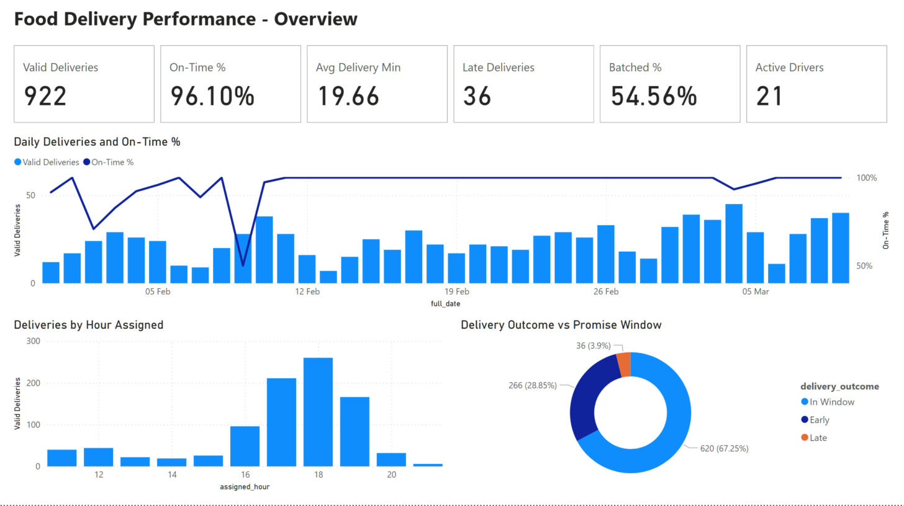
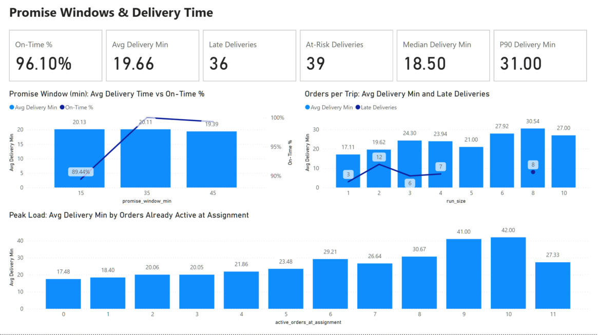
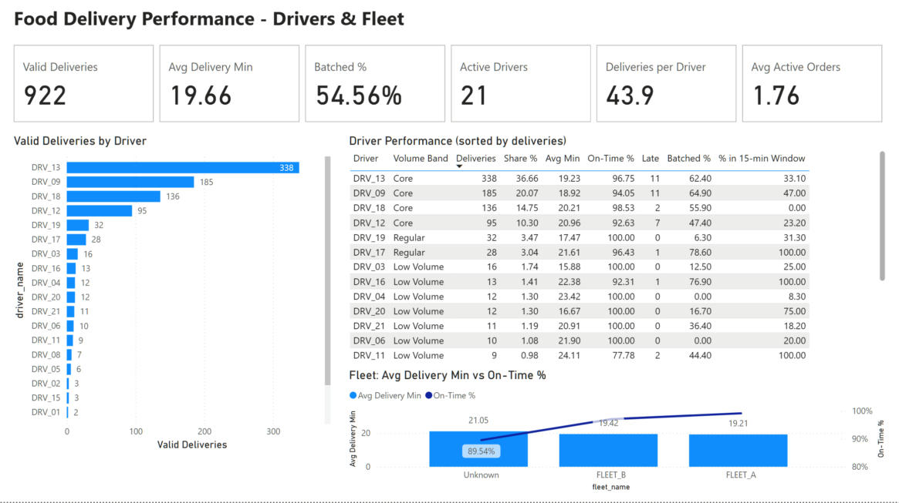
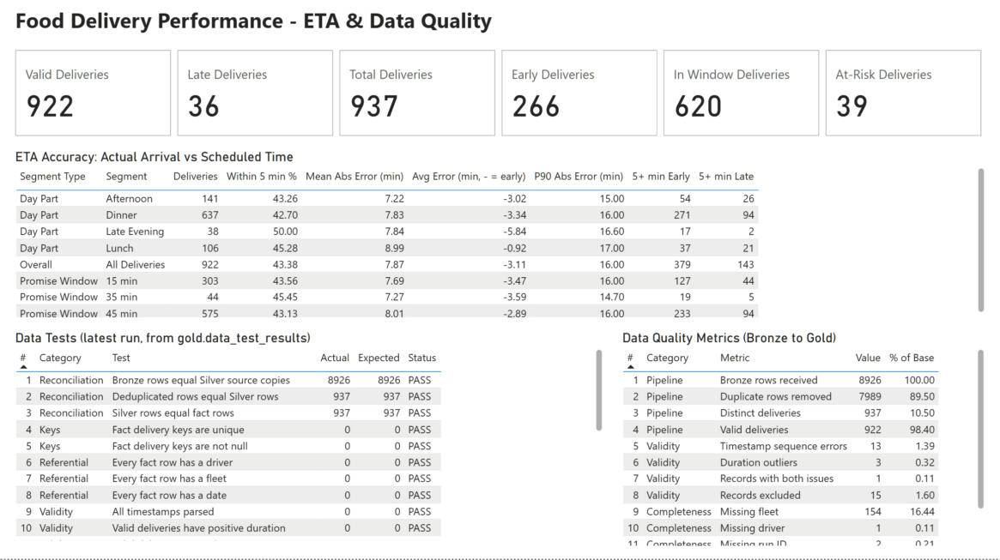

# Food Delivery Lakehouse

An end-to-end data engineering and analytics project on Databricks, built on an anonymized delivery dataset from a quick-service restaurant. Raw CSV data moves through Bronze, Silver, and Gold Delta tables in Unity Catalog, gets checked by 24 automated data tests, and feeds a four-page Power BI dashboard.



## Architecture

```
deliveries_anonymized.csv
        │  COPY INTO (idempotent)
        ▼
Bronze  workspace.bronze.deliveries          8,926 raw rows, all strings, duplicates kept
        │  GROUP BY ALL
        ▼
Silver  workspace.silver.deliveries_deduped  937 distinct deliveries + source_copies
        workspace.silver.deliveries          typed timestamps, durations, quality flags
        │
        ▼
Gold    dim_date, dim_driver, dim_fleet      star schema
        fact_deliveries                      one row per delivery
        10 KPI tables                        daily, hourly, stages, promise, ETA,
                                             drivers, fleet, batching, peak load, data quality
        data_test_results                    history of 24 data tests
        │  Databricks connector (Import)
        ▼
Power BI  food_delivery_dashboard            4 pages, 14 DAX measures
```

Built on Databricks Free Edition with serverless SQL. Every step is a SQL notebook in [`sql/`](sql/).

| Notebook | What it does |
|---|---|
| [`00_setup.sql`](sql/00_setup.sql) | Schemas and landing volume |
| [`01_bronze_ingestion.sql`](sql/01_bronze_ingestion.sql) | `COPY INTO` a string-typed Bronze table with load metadata |
| [`02_silver_dedup.sql`](sql/02_silver_dedup.sql) | Collapse duplicates and keep a `source_copies` count |
| [`03_silver_clean.sql`](sql/03_silver_clean.sql) | Parse timestamps, calculate durations, flag sequence errors and outliers |
| [`04_gold_dimensions.sql`](sql/04_gold_dimensions.sql) | Date, driver, and fleet dimensions with hashed keys |
| [`05_gold_fact.sql`](sql/05_gold_fact.sql) | Fact table with stage times, promise metrics, trip size, and concurrent load |
| [`06_gold_kpis.sql`](sql/06_gold_kpis.sql) | Ten KPI tables for reporting |
| [`07_data_tests.sql`](sql/07_data_tests.sql) | 24 checks written to a results table on every run |
| [`08_gold_incremental_merge.sql`](sql/08_gold_incremental_merge.sql) | Refresh dimensions and the fact table in place with `MERGE`, using a row hash to skip unchanged rows |
Notebook `05` builds the fact table from scratch. After that, `08` keeps it current: it inserts new deliveries, updates changed ones, deletes removed ones, and leaves unchanged rows alone. Running it twice in a row changes 0 rows the second time.

## Data and anonymization

The source export had 8,926 rows but only 937 distinct deliveries: each record had been copied up to 21 times with a randomized `Created At` value. Bronze keeps the rows as received, and Silver removes the duplicates. That makes the cleaning step visible and testable instead of hiding it before ingestion.

Before upload, [`scripts/anonymize.py`](scripts/anonymize.py):

- replaces order IDs with salted HMAC hashes and replaces run, driver, fleet, and store names with neutral labels
- shifts every timestamp by a private number of whole weeks, which keeps durations, hours, and weekdays intact
- removes a vendor-specific column

Only a 25-delivery sample is committed, in [`data/sample/`](data/sample/). The source file, the full anonymized file, the mapping secrets, and the `.pbix` file (which embeds the imported data) are excluded from Git.

## Data quality

Silver flags two kinds of bad records:

- **Sequence errors (13):** timestamps out of order, for example a customer check-in before the store check-out
- **Duration outliers (3):** more than 90 minutes from dispatch to door, or more than 30 minutes at the customer

One record has both problems, so 15 are excluded. That leaves 922 of 937 deliveries (98.40%) valid for analysis. Fleet is missing for 16.44% of deliveries, and customer rating for 98.19%.

`07_data_tests.sql` checks row reconciliation from Bronze to Gold, key uniqueness, referential integrity, timestamp validity, and that every KPI table adds back to the fact table. All 24 tests pass on the latest run.

## Findings

All figures cover the 922 valid deliveries.

- **Better on-time rates came from a longer promise, not faster delivery.** The promise window grew from 15 to 35 to 45 minutes, while average delivery time stayed close to 20 minutes in each period. On-time delivery rose from 89.44% to over 99%, and 32 of the 36 late orders happened under the 15-minute window.
- **Dinner drives the operation.** The 5 to 8 PM orders make up 69% of deliveries and 29 of the 36 late orders.
- **Batching adds time.** Single-order trips average 17.1 minutes, while trips with 3 or more orders average 21 to 31 minutes. Under the 45-minute window, the third stop on a trip averages 30.2 minutes, compared with 16.9 for the first.
- **Load slows delivery.** Delivery time rises from 17.5 minutes when no other order is active to 27 to 31 minutes at 6 to 8 active orders. Single-order trips slow down too, so the delay isn't only from batching.
- **Scheduled arrival times are unreliable.** Only 43% of deliveries arrive within 5 minutes of the scheduled time, and drivers arrive 3.1 minutes early on average.
- **Work is concentrated.** The top 4 of 21 drivers handle 82% of deliveries.

The high-load and large-trip groups contain few deliveries, so treat those values as indicators rather than precise estimates.

## Dashboard

The Power BI report connects to the Gold tables through the Databricks connector. The DAX measures are in [`powerbi/measures.dax`](powerbi/measures.dax).

| Promise windows and delivery time | Drivers and fleet |
|---|---|
|  |  |

| ETA accuracy and data quality |
|---|
|  |

## Run it yourself

1. Run the anonymization script on a source export:

   ```powershell
   pip install -r requirements-dev.txt
   pytest
   python scripts/anonymize.py --input path/to/source.csv
   ```

2. In Databricks, import the files in `sql/` as notebooks and run `00_setup.sql`.
3. Upload `data/anonymized/deliveries_anonymized.csv` to `/Volumes/workspace/bronze/landing/`.
4. Run notebooks `01` to `07` in order. The last cells of `07_data_tests.sql` should show 0 failed tests.
5. Run `08` (cell 1 only the first time). On later loads, run `01` to `03`, then `08`, `06`, and `07`.
6. In Power BI Desktop, connect to the Gold tables with the Databricks connector, rename the tables to their short names, and add the measures from `powerbi/measures.dax`.

## Roadmap

- [x] Project setup and anonymization
- [x] Bronze ingestion with `COPY INTO`
- [x] Silver deduplication, cleaning, and quality flags
- [x] Gold star schema and KPI tables
- [x] Data tests with stored history
- [x] Power BI dashboard
- [x] Incremental Gold refresh with `MERGE`
- [ ] Databricks Workflow to run the pipeline on a schedule
